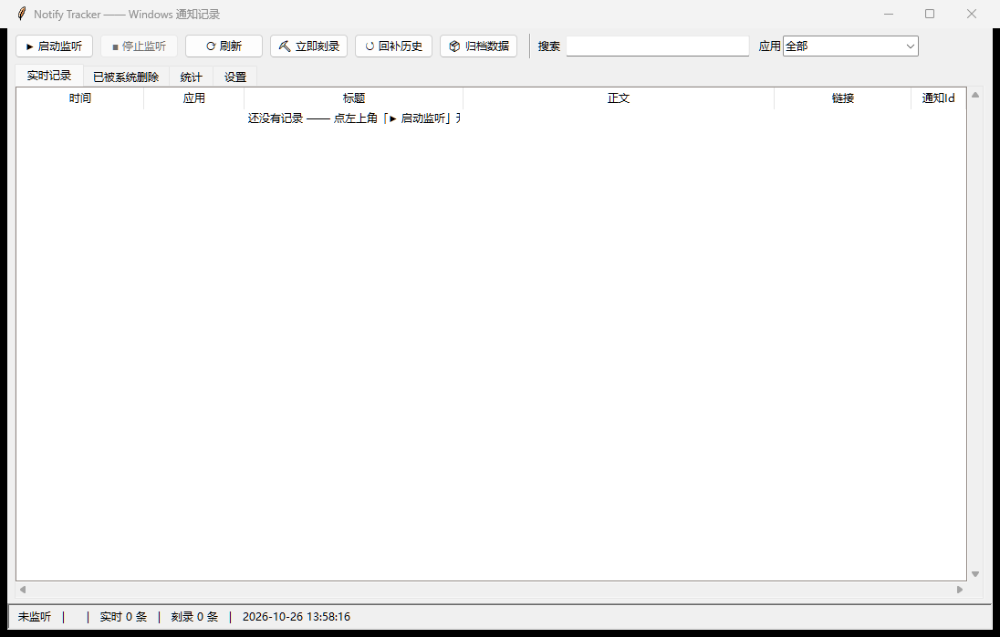

# Notify Tracker

**Keep a searchable text log of your Windows notifications — including the ones
that auto-dismissed, got swallowed by Do Not Disturb, or were already deleted by
the system.**

Windows 通知会自动消失、被勿扰模式吞掉、被系统轮换清理，而且系统不给你任何可搜索的历史。
Notify Tracker 直接读取 Windows 自己的通知数据库，把每一条通知存成文字表格，
还能从数据库的空闲页里把**已被系统删除**的通知刻录回来。全程不截屏、不录屏、不联网。



## 为什么可行

Windows 把每一条通知（含完整正文 XML）写进：

```
%LOCALAPPDATA%\Microsoft\Windows\Notifications\wpndatabase.db
```

这是一个 SQLite 数据库。以**只读**方式打开它不会触发 WAL 检查点，因此不会破坏任何数据；
读取游标用 `Notification.Id`（单调递增，与库内 `Metadata.CurrentNotificationId` 一致）。
注意**不能用 `Order` 列**：旧行被删除后 Windows 会给剩下的行重新编号，拿它当游标会静默漏掉新通知。

## 三种能力

| | 做什么 | 成本 | 依赖 |
|---|---|---|---|
| **监听** | 新通知一到就追加进 CSV / JSONL | 空闲 <0.1% 单核，内存约 10–30 MB | 仅标准库 |
| **刻录** | 从空闲页和 WAL 里捞回已被系统删除的通知 | 每 10 分钟几 MB 顺序读 | 仅标准库 |
| **录屏**（可选） | 录制屏幕右下角小区域成 mp4，用于自绘弹窗类应用 | 5 fps，约 15 MB/小时 | `mss` + `opencv-python` |

被勿扰模式拦截、**屏幕上根本没显示过**的通知同样会被记录（已实测）。

## 安装

需要 Python 3.10+（Windows 10/11）。核心功能零依赖：

```bash
git clone <本仓库>
cd notify-tracker
python app.py
```

只有录屏功能需要额外依赖：

```bash
pip install -r requirements.txt
```

## 使用

### 图形界面

双击 `run_gui.bat` 或运行 `python app.py`：

- **▶ 启动监听 / ■ 停止监听**：内置单实例锁，重复启动会自动退出，不会写重复记录
- **⟳ 刷新 / 搜索 / 应用筛选**：表格按应用过滤、全文搜索，双击行即复制
- **⛏ 立即刻录**：手动扫一次空闲页和 WAL
- **↺ 回补历史**：调用内置的 toastcrumbs 生成 `recovered/history.csv` 和可视化时间线
- **📦 归档数据**：把已采集的数据打包成 zip 并清空工作目录（发布或分享前清理隐私）
- **设置**：安装/取消开机自启、检查间隔、刻录间隔、关键词过滤、导出当前表格

四个标签页：`实时记录`、`已被系统删除`、`统计`（按天/按应用的条形分布）、`设置`。

### 命令行

```bat
start_log.bat                     :: 带控制台运行监听（Ctrl+C 停止）
start_log_background.vbs          :: 静默后台运行；复制到"启动"文件夹即开机自启
stop_log.bat                      :: 停止后台实例
status_log.bat                    :: 查看是否在运行、条数、最新几条，并刷新 xlsx
recover.bat                       :: 一次性回补全部可恢复历史
dump_history.bat                  :: 直接看系统里现存的历史

python notify_log.py --dump 40                        :: 现存历史
python notify_log.py --replay --since today --once     :: 补记今天，跑一次退出
python notify_log.py --exclude "关键词" --carve-every 10
python -m toastcrumbs.cli list --limit 40              :: 含已删除记录的完整时间线
```

`notify_log.py --help` 有全部参数。GUI 和命令行共用同一套文件与游标，可以混着用。

## 数据与隐私

所有数据都留在本机，程序不联网、不上传。

输出文件：

- `logs/notifications.csv` —— 时间 / 应用 / AppId / 标题 / 正文 / 链接 / 按钮 / 类型 / 通知Id / 位置序号
- `logs/notifications.jsonl` —— 同样内容外加**原始 Toast XML**，方便自己写脚本解析
- `logs/carved.csv` —— 刻录回来的、已被系统删除的通知（无时间戳，标注完整度与来源偏移）
- `recovered/history.csv`、`recovered/notifications.html` —— 一次性全量回补结果

## 局限（重要）

- **正文长度由发送方决定。** Toast 的设计就是"标题 + 两三行摘要"：同一段聊天的连续消息会被
  合并成一条通知（`醉月(5条新消息)` 这种），只带最新一句，前面的文字从来没进过 Windows，
  任何记录工具都取不到。想拿全文只能去源头（邮件走 IMAP，聊天软件读各自的本地库）。
  作为补偿，通知深链会被提取到 `链接` 列——例如 QQ 邮件通知里带着 `mailid=…` 的真实
  https 地址，点开就是完整邮件。
- **刻录出来的记录没有时间戳。** 时间存在 SQLite 行记录里，而空闲页上只剩 payload，
  所以刻录项只能证明"出现过、写了这些字"，无法确定何时、由哪个应用（应用名会从按钮参数
  或深链协议尽力推断，并用 `应用名来源` 列标出可信度）。
- **自绘弹窗不进数据库。** 少数应用自己画通知窗口而不走系统 API，这类只能靠录屏。
- 录屏用 GDI 抓屏，独占全屏游戏和部分 DRM 画面录不到。

## 实测数据

本机连续运行 6 天：实时表 2048 条、刻录表 335 条；
对账脚本比对数据库现存 toast 与已记录 Id，**漏网 0 条**；
期间经历 2 次系统重启，开机自启均在 1 分钟内恢复监听。

## 第三方代码

`toastcrumbs/` 是 [mikmok5/toastcrumbs](https://github.com/mikmok5/toastcrumbs)（MIT，
`LICENSE` 已随文件保留）的原样内置，负责从空闲页和 WAL 刻录已删除记录。
它的思路参考了 [kacos2000 的 schema 笔记](https://github.com/kacos2000/Win10/tree/master/Notifications)
和 [Velociraptor 的通知数据库 artifact](https://docs.velociraptor.app/exchange/artifacts/pages/windows.forensics.notificationsdatabase/)。

## 许可

MIT —— 见 [LICENSE](LICENSE)。
